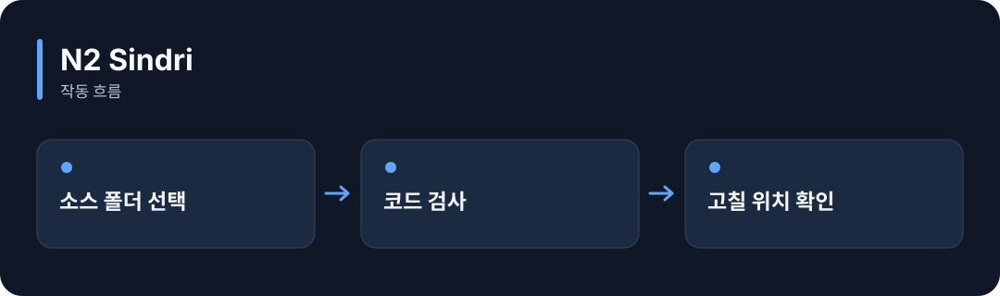

# N2 Sindri

**소스 코드를 읽고 문법 오류와 정해 둔 코드 품질 문제를 찾아줍니다.**

[](https://github.com/choihyunsus/n2-sindri/releases/tag/v1.0.0) [](https://github.com/choihyunsus/n2-sindri/blob/main/docs/reference.ko.md) [](https://github.com/choihyunsus/n2-sindri/blob/main/LICENSE)

[English](README.md)



## 이런 때 사용하세요

AI가 코드를 고친 뒤 빠진 문법이나 지나치게 긴 함수를 확인하고, 검사 결과를 작업 완료 조건으로 사용할 수 있어요.

Rust와 C/C++ 빌드 도구가 필요합니다. 프로그램을 실행했을 때의 동작은 프로젝트 테스트로 함께 확인하세요.

## 처음 실행하기

Rust 1.98 이상과 C/C++ 빌드 도구를 준비하세요. Windows에서는 Visual Studio C++ Build Tools가 필요합니다. 터미널에서 다음 명령으로 설치합니다.

```sh
cargo install --git https://github.com/choihyunsus/n2-sindri --tag v1.0.0 --locked
```

검사할 소스 파일이 있는 프로젝트에서 실행하세요.

```sh
n2-sindri --dir ./src
```

`passed`는 검사 통과 여부, `blockers`는 먼저 고쳐야 할 항목, `warnings`는 검토할 항목입니다. 결과에 표시된 파일과 줄을 확인하고 수정 후 다시 검사하세요. 검사할 파일이 없으면 실패로 표시됩니다.

## Soul과 함께 쓰기

이 모듈은 자체 DB 없이 사용할 수 있습니다. 결과를 기억하려면 연결한 앱에서 Soul의 `n2_kv_save`를 호출해 저장하세요.

## 다음 단계와 상세 안내

[전체 사용 안내](https://github.com/choihyunsus/n2-sindri/blob/main/docs/reference.ko.md)에서 실제 앱 연결, API, 지원 범위, 복구 절차와 검증 범위를 확인할 수 있습니다. [배포 파일](https://github.com/choihyunsus/n2-sindri/releases/tag/v1.0.0)에는 설치할 버전과 변경 설명이 있습니다.

처음 나오는 용어는 이렇게 읽으면 됩니다. **MCP**는 AI 앱의 도구 연결 방식, **DB**는 저장 파일, **호스트**는 이 모듈을 연결해 실행하는 앱입니다.

사용·재배포 조건은 [라이선스](https://github.com/choihyunsus/n2-sindri/blob/main/LICENSE)를 확인하세요. 의존 모듈에는 별도 조건이 적용될 수 있으며, 상업 이용 조건은 상세 안내에 함께 설명되어 있습니다.
