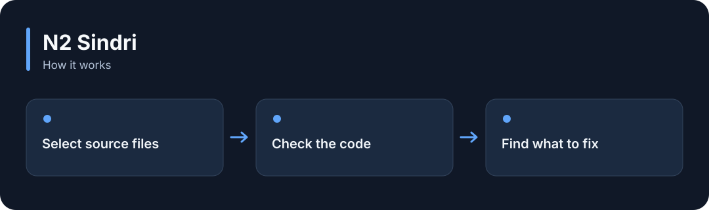

# N2 Sindri

**Read source files and find syntax errors and defined code-quality problems.**

[](https://github.com/choihyunsus/n2-sindri/releases/tag/v1.0.0) [](https://github.com/choihyunsus/n2-sindri/blob/main/docs/reference.md) [](https://github.com/choihyunsus/n2-sindri/blob/main/LICENSE)

[한국어](README.ko.md)

<p align="center">
  
</p>

Read source files and find syntax errors and defined code-quality problems.

A story illustrating the feature, rather than a screenshot of the app.

<details>
<summary>View the workflow</summary>



</details>

## When to use it

After an AI edits code, check for broken syntax or oversized functions and use the report as a completion requirement.

Installation needs Rust and C/C++ build tools. Check runtime behavior with your project tests as well.

## Try it

Install Rust 1.98 or later and C/C++ build tools. On Windows, use Visual Studio C++ Build Tools. Then run this in a terminal.

```sh
cargo install --git https://github.com/choihyunsus/n2-sindri --tag v1.0.0 --locked
```

Run this inside a project that has source files.

```sh
n2-sindri --dir ./src
```

`passed` gives the gate result, `blockers` lists required fixes, and `warnings` lists items to review. Inspect the file and line shown, edit, then scan again. A scan with no supported files fails.

## Using it with Soul

This module works without its own database. To remember its results, have your app save them through Soul’s `n2_kv_save` tool.

## Next steps and reference

The [full reference](https://github.com/choihyunsus/n2-sindri/blob/main/docs/reference.md) covers app integration, APIs, supported features, recovery and validation. The [release page](https://github.com/choihyunsus/n2-sindri/releases/tag/v1.0.0) contains the installable version and release notes.

A few terms used in the reference: **MCP** connects tools to an AI app, a **database** stores records, and the **host** is the app that connects and runs this module.

Review the [license](https://github.com/choihyunsus/n2-sindri/blob/main/LICENSE) for use and redistribution. Dependencies can have their own terms, including commercial-use conditions described in the reference.
